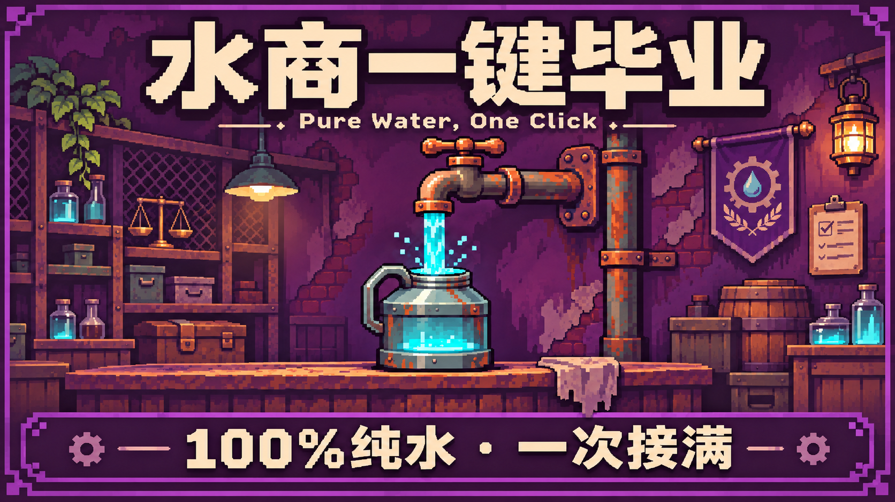

[简体中文](README.md) · [繁體中文](README.zh-Hant.md) · [English](README.en.md)

Wilde has added a filter to your faucet! Your faucet can now unlock pure water!


[Steam Workshop](https://steamcommunity.com/sharedfiles/filedetails/?id=3841987033) · [GitHub](https://github.com/IEmaster/WaterMerchantGraduate) · [Latest download](https://github.com/IEmaster/WaterMerchantGraduate/releases/latest)



# Pure Water, One Click 1.1.0

Pure Water, One Click
100% pure water straight from the faucet. Fill all remaining container capacity in one use.

Before you graduate
This may trivialize water purification and resource management, shortening the game's lifespan. It might extend the player's lifespan instead—less grinding, more living.

How to use
Subscribe, enable the mod and restart when prompted. Use a container on a faucet as in the base game. No extra hotkey, panel, AI or companion mod is required.

Features

- New water from faucets is 100% pure.
- Removes the roughly 10 L per-use limit; fills the container's remaining space.
- Normal and advanced tooltips both show pure-water output and Water 100.00%.
- Works independently. When Item Details is enabled, its old faucet quality table is replaced by the matching pure-water tooltip.
- No network access or extra permission is required.


Important details

- The native unlock requirement remains: connect a water-supply line first.
- Existing liquids and contaminants are preserved and mixed with the new water. Use an empty container for a full container of 100% pure water.
- Container capacities, other water sources and chemicals are unchanged.
- Disabling restores native behavior. Water already collected stays in your containers.


Languages
Simplified Chinese, Traditional Chinese and English. The default follows the game. To choose explicitly, open this mod's settings in the game Modding menu and set Language. Changes apply immediately. English is the fallback for other languages. The Workshop cover is Chinese/English bilingual.

Built for the current 0.46D / VERSION 100-Rev13 API.

## Installation from GitHub

Download the release ZIP and extract its contents into `Probably Stolen/Mods/WaterMerchantGraduate/` so that `manifest.xml` and the DLL are directly inside that folder. Enable the mod in game and restart when prompted. Use either Workshop or manual installation to avoid duplicate copies.

## Build and test

Requires Windows, PowerShell, Visual Studio Build Tools with the C# compiler, and your own game installation. Game, Unity and Harmony assemblies are referenced from the game and are not redistributed.

```powershell
.\build.ps1 -GamePath "D:\SteamLibrary\steamapps\common\Probably Stolen" -Tests
```

You may pass `-CompilerPath` explicitly. The script builds `package/`, runs the native permission scanner and optional boundary simulations, then creates `dist/WaterMerchantGraduate-1.1.0.zip`. The tests do not automate the game UI.

## Layout and translations

- `src/`: mod sources, including generated localization.
- `package/`: installable mod, textures, manifest and native localization CSV files.
- `tests/`: boundary simulations.
- `localization/strings.json`: translation source for Simplified Chinese, Traditional Chinese and English.

After editing translations, run `python tools/generate-localization.py`, then rebuild. Keep mod and item IDs unchanged for save compatibility.

## Cover and gallery

The main cover is 16:9 landscape. The original square artwork remains in the Workshop gallery. Artwork-only update; gameplay version unchanged.

[Original square artwork](https://raw.githubusercontent.com/IEmaster/WaterMerchantGraduate/main/docs/cover.png)
