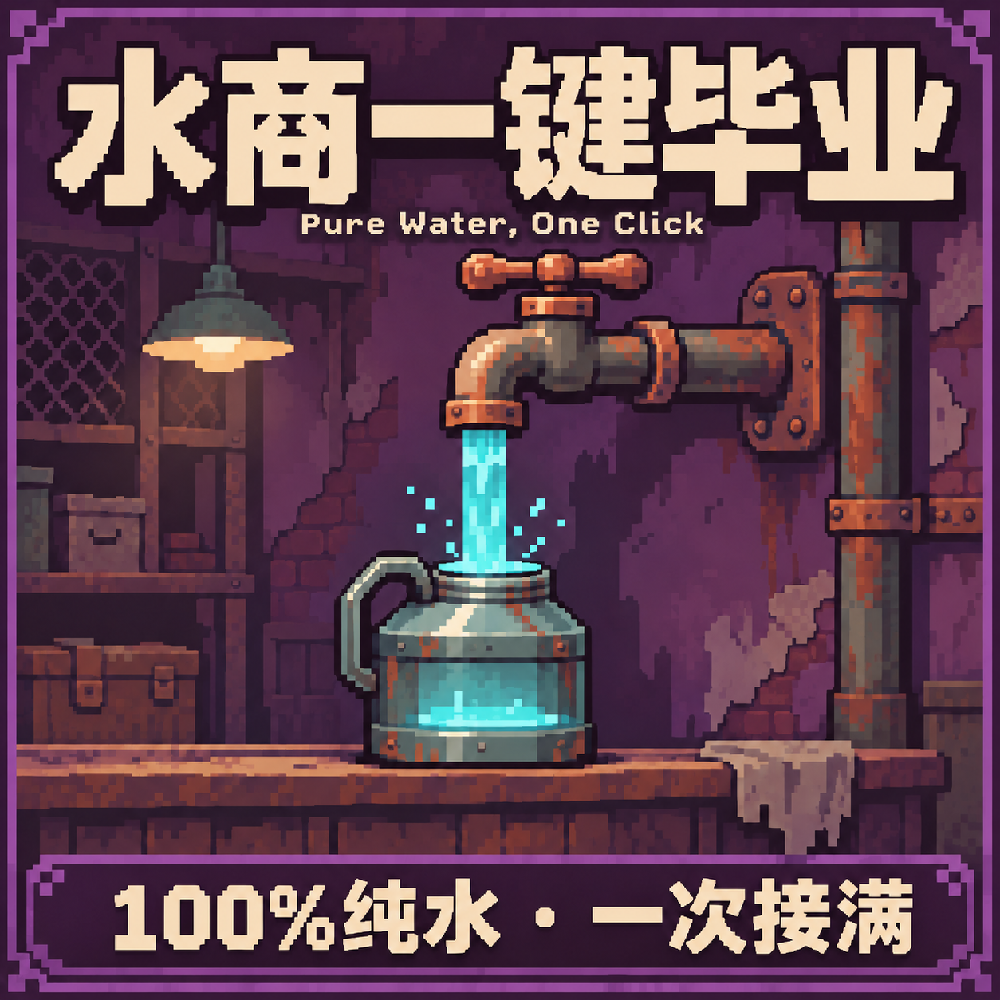

[简体中文](README.md) · [繁體中文](README.zh-Hant.md) · [English](README.en.md)

[Steam 创意工坊](https://steamcommunity.com/sharedfiles/filedetails/?id=3841987033) · [GitHub Releases](https://github.com/IEmaster/WaterMerchantGraduate/releases)



# 水商一键毕业 1.1.0

启用后，将容器按原版方式对水龙头使用：水龙头添加的水统一为100%纯水，并一次填满容器剩余容量。无需热键、面板、AI或额外依赖。

## 毕业前提醒

可能破坏净水和资源管理的游戏体验，缩短游戏寿命；也可能延长玩家寿命——毕竟少肝一点。

## 同步前端

水龙头普通悬停提示与高级详情统一显示“出水水质：纯水”和“水 100.00%”。没有安装“物品详情”也能看到；已安装时，旧的铁锈水/污染物水质表由本模组的水龙头提示替换。

## 使用边界

- 保留原版供水管线解锁条件：先接通任意一条供水管线。
- 只修改水龙头新增的水；容器里原有液体和污染物不会被删除。要获得整瓶100%纯水，请先用空容器。
- 不改变容器本身容量；已满容器不再添加。
- 不修改其它水源、药剂、商品价格或网络升级进度。
- 停用后恢复原版出水与提示逻辑；已经接到容器里的水保留。

## 安装

订阅后在游戏模组菜单启用，按游戏提示重启。当前构建针对游戏0.46D（VERSION 100-Rev13）的API。无需其它创意工坊模组，不需要网络或文件访问权限。

验证包括原生权限扫描与代码层模拟测试；模拟不等于游戏内实测。

## 语言 / 語言 / Language

支持简体中文、繁體中文、English。默认跟随游戏语言；可在模组设置的Language中手动切换并即时生效。原版游戏可能将繁体环境映射为zh，需要繁体时请选择“繁體中文”。未适配语言回退至英文。工坊封面为中英双语。

## GitHub 手动安装 / 手動安裝

从 Releases 下载 ZIP，将内容解压至 `Probably Stolen/Mods/WaterMerchantGraduate/`，确保 `manifest.xml` 与 DLL 直接位于该目录。游戏内启用并按提示重启。工坊订阅和手动安装选一种即可。

## 构建与测试 / 建置與測試

需要 Windows、PowerShell、Visual Studio Build Tools 的 C# 编译器及自己的游戏安装。游戏、Unity 和 Harmony 程序集从游戏目录引用，不随仓库分发。

```powershell
.\build.ps1 -GamePath "D:\SteamLibrary\steamapps\common\Probably Stolen" -Tests
```

可以用 `-CompilerPath` 指定编译器。构建脚本输出到 `package/`，执行原生权限扫描与代码模拟测试，并生成 `dist/WaterMerchantGraduate-1.1.0.zip`。测试不控制游戏窗口。

`src/` 为源码，`tests/` 为测试，`package/` 为安装内容。编辑 `localization/strings.json` 后，运行 `python tools/generate-localization.py` 再重新构建。请保留模组及物品ID，以兼容已有存档。
