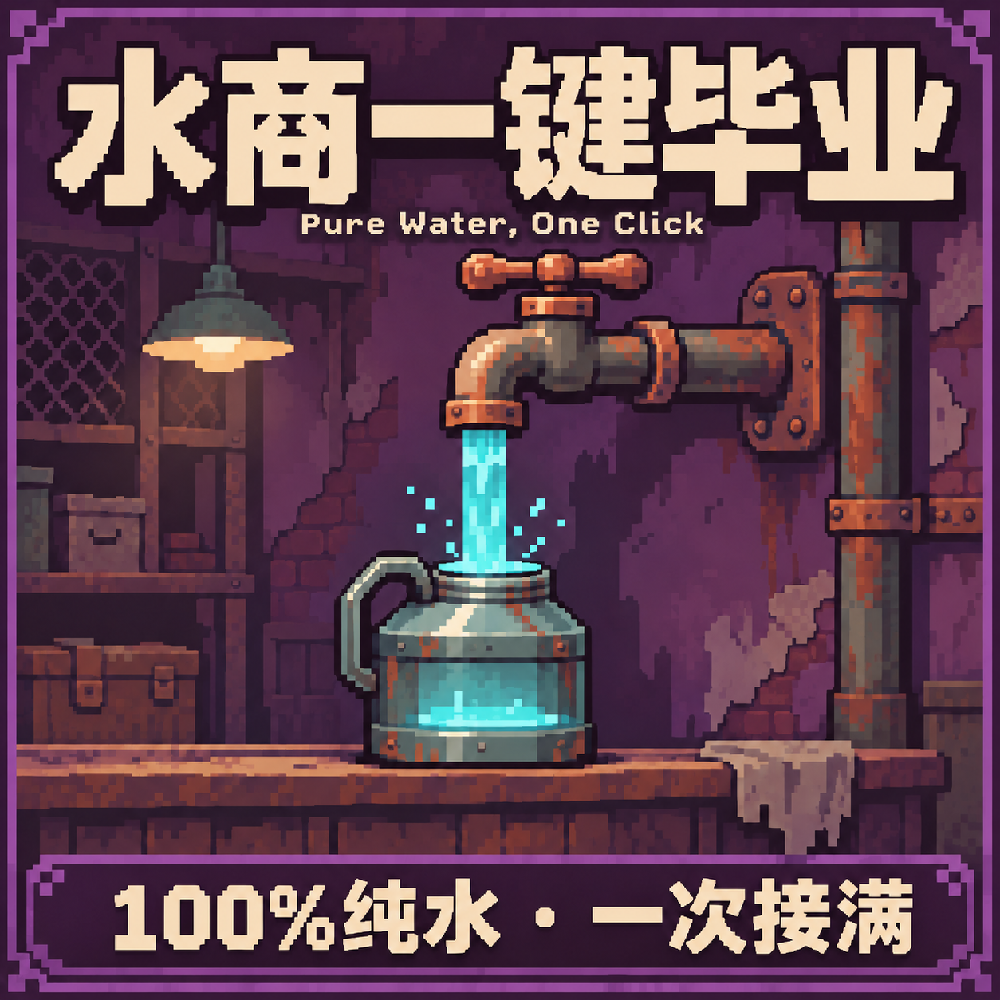

[简体中文](README.md) · [繁體中文](README.zh-Hant.md) · [English](README.en.md)

[Steam 創意工坊](https://steamcommunity.com/sharedfiles/filedetails/?id=3841987033) · [GitHub](https://github.com/IEmaster/WaterMerchantGraduate) · [最新下載](https://github.com/IEmaster/WaterMerchantGraduate/releases/latest)



# 水商一鍵畢業 1.1.0

水商一鍵畢業
水龍頭直接輸出100%純水，一次接滿容器剩餘容量。

畢業前提醒
可能破壞淨水與資源管理的遊戲體驗，縮短遊戲壽命；也可能延長玩家壽命——畢竟少肝一點。

使用方式
訂閱並啟用模組，依提示重新啟動遊戲。按照原版方式將容器對水龍頭使用即可，無需額外快捷鍵、面板、AI或配套模組。

功能

- 水龍頭新增的水統一為100%純水。
- 取消原版單次約10L的接水限制，一次接滿容器剩餘空間。
- 一般懸停與進階詳情同步顯示「出水水質：純水／水100.00%」。
- 獨立運作；與「物品詳情」同時啟用時，以符合實際出水的純水提示替換舊水質表。
- 不連網、不接AI，無需額外權限。


注意事項

- 保留原版解鎖條件，須先接通任一供水管線。
- 不會刪除容器中既有液體或污染物，新水會與其混合。要取得整瓶100%純水，請使用空容器。
- 不改變容器容量、其他水源及化學品。
- 停用後恢復原版行為，已接的水會保留。


語言
支援簡體中文、繁體中文與英文，預設跟隨遊戲。可在遊戲模組選單中開啟本模組設定，於Language選擇「繁體中文」，立即生效。其他語言回退至英文。工坊封面採中英雙語。

適用目前0.46D／VERSION 100-Rev13 API。

## GitHub 手动安装 / 手動安裝

从 Releases 下载 ZIP，将内容解压至 `Probably Stolen/Mods/WaterMerchantGraduate/`，确保 `manifest.xml` 与 DLL 直接位于该目录。游戏内启用并按提示重启。工坊订阅和手动安装选一种即可。

## 构建与测试 / 建置與測試

需要 Windows、PowerShell、Visual Studio Build Tools 的 C# 编译器及自己的游戏安装。游戏、Unity 和 Harmony 程序集从游戏目录引用，不随仓库分发。

```powershell
.\build.ps1 -GamePath "D:\SteamLibrary\steamapps\common\Probably Stolen" -Tests
```

可以用 `-CompilerPath` 指定编译器。构建脚本输出到 `package/`，执行原生权限扫描与代码模拟测试，并生成 `dist/WaterMerchantGraduate-1.1.0.zip`。测试不控制游戏窗口。

`src/` 为源码，`tests/` 为测试，`package/` 为安装内容。编辑 `localization/strings.json` 后，运行 `python tools/generate-localization.py` 再重新构建。请保留模组及物品ID，以兼容已有存档。
